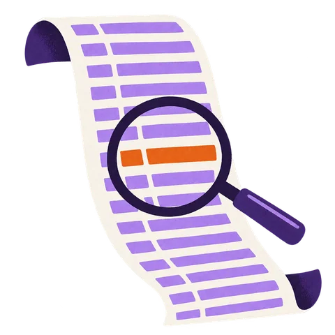

# Questions

{ .lb-spot .no-zoom width="480" height="480" }

Hunt on your own and check your answers as you go. Your progress is only saved in this browser. Each question has a hint, the answer, and a link to the part of the walkthrough that covers it.

Answers aren't case sensitive unless the question says so. When a question asks for several values, separate them with commas, in any order.

<!-- questions: labs/001/questions.json -->
