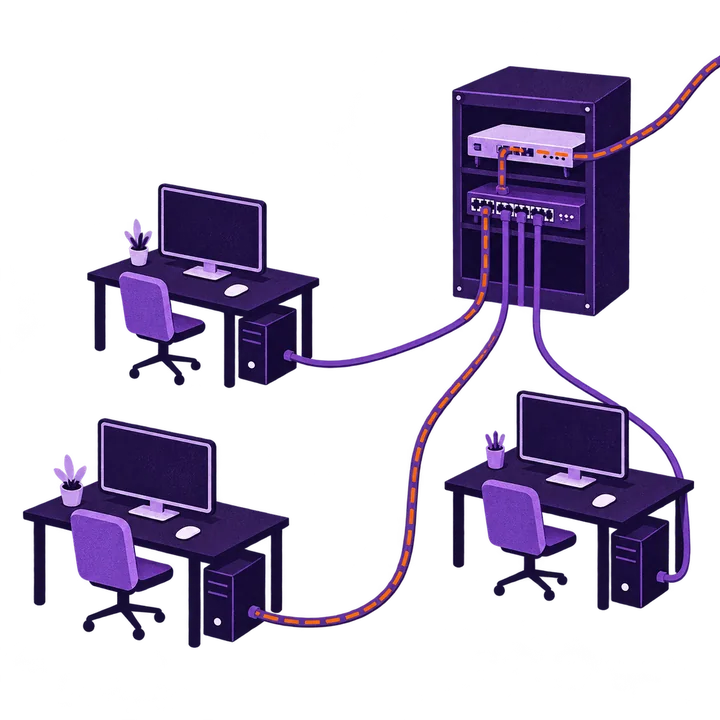
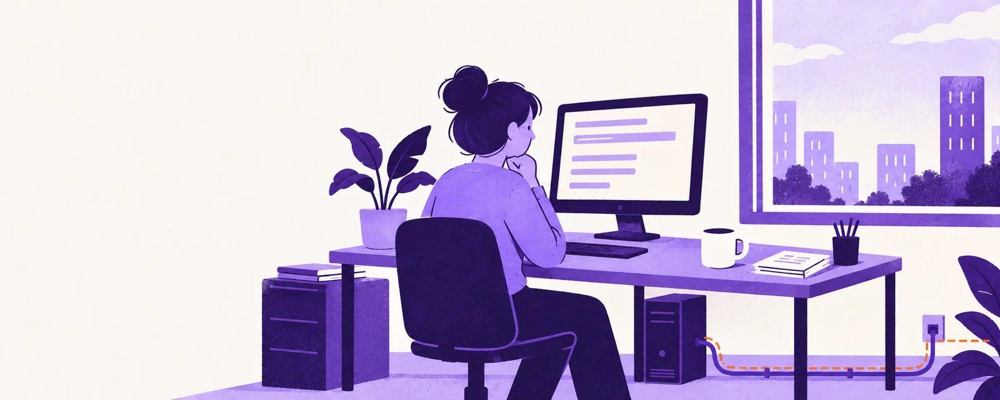

---
hide:
  - navigation
  - toc
---

{ .lb-art .no-zoom width="720" height="720" }

# Bifract Labs

Labs for [Bifract](https://github.com/zaneGittins/bifract). Each lab is a dataset, questions, and a lab guide. Import it into your Bifract from the [Exchange](https://docs.bifract.io/exchange/), or run it in a free [GitHub Codespace](001/setup.md#no-bifract-yet-use-codespaces).

[Start lab 001](001/index.md){ .md-button .md-button--primary }
[Get Bifract](https://docs.bifract.io/getting-started/installation/){ .md-button }

## Labs

{ .lb-cover .no-zoom width="1600" height="640" }

Lab 001

### [Meridian workstation intrusion](001/index.md)

A user pastes a command they were told to run, and an attacker takes it from there.

Sysmon · Windows events · Zeek · 2.08M events · 5 hosts · 31 questions

[Open lab](001/index.md){ .md-button .md-button--primary }

